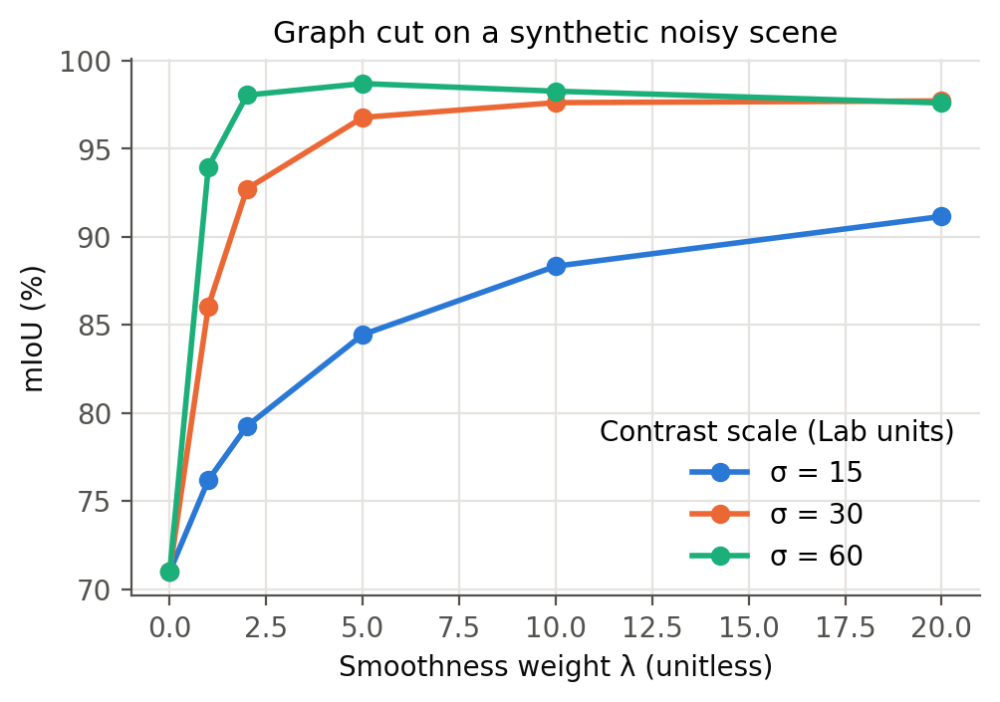

# Flood Segmentation: Graph Cut vs U-Net vs SegFormer-B0

## 1. Introduction

Flood segmentation assigns a binary flood label to each pixel in an image. The task supports visual assessment of inundated areas and flood mapping across different image sources. This project compares three approaches: the classical Graph Cut method, a U-Net trained from scratch, and SegFormer-B0 fine-tuned from pretrained weights. The comparison is designed to distinguish a feature-and-energy-based classical method from two learned segmentation approaches with different model designs.

The project uses FloodNet as the primary UAV dataset and adds the Flood Area Segmentation and Roadway Flooding datasets to represent aerial and street-level imagery. It also includes ten team-labelled Philippine flood photos for local-domain testing. The central research question is: how do a classical Graph Cut, a from-scratch U-Net, and a pretrained SegFormer-B0 compare in segmentation quality, efficiency, data requirements, and robustness across test domains?

## 2. Methods

### 2.1 Data and Binary Label Definition

Four data sources are represented in the repository:

- FloodNet Supervised v1.0: 1,445 training, 450 validation, and 448 test images.
- Flood Area Segmentation: 290 images, divided into 203 training, 44 validation, and 43 test images.
- Roadway Flooding: 441 images, divided into 309 training, 66 validation, and 66 test images.
- Local Philippine photos: ten team-labelled street and yard flood photographs used for testing.

The split IDs are stored in `splits/`; the corresponding counts are consistent with the repository documentation and split files. FloodNet class IDs are mapped to a binary flood mask by setting IDs 1 (building-flooded), 3 (road-flooded), and 5 (water) to flood; IDs 0, 2, 4, 6, 7, 8, and 9 are non-flood classes. Kaggle and Roadway masks are already binary. The mapping is implemented in `src/data/classes.py`.

The repository uses two main training configurations. The `train` configuration uses FloodNet training data only. The `mixed` configuration combines the FloodNet, Kaggle, and Roadway training splits and validates against the matching validation splits. Images are stored at a maximum side length of 1,024 pixels. The deep models operate at 512 pixels, and Graph Cut operates at 256 pixels. Predicted masks are resized to the original image dimensions before evaluation. These preprocessing and split choices are implemented in `src/data/dataset.py`.

For deep-model training, images are resized to a maximum side length of 512 pixels. Training augmentation includes random resized cropping to 384 pixels, horizontal and vertical flips, and color jitter. BCE and Dice loss are combined as the training objective. Training uses AdamW and cosine learning-rate scheduling, with early stopping based on validation mIoU. The shared implementation is in `src/utils/train.py`.

### 2.2 Graph Cut

The Graph Cut method is implemented from scratch rather than through a pre-existing graph-cut library. It uses CIE Lab color, two local-lightness texture scales with window sizes of 7 and 21 pixels, and row position as features. Flood and background distributions are modeled with five-component full-covariance Gaussian mixture models. The unary cost is the negative log-likelihood of the feature vector under each class distribution, with an additional flood-bias term.

A contrast-sensitive Potts pairwise cost encourages neighboring pixels with similar Lab values to receive the same label. The binary energy is minimized using the repository's implementation of the Boykov-Kolmogorov max-flow algorithm on a 256-pixel grid. The segmentation is then resized back to the original image dimensions.

The model is fitted on training pairs and has tunable `lambda`, `sigma`, and flood-bias parameters. The `fit_classical.py` script samples up to 40 validation images per validation set and searches over smoothness weights 0, 5, 10, 20, 40, and 80; sigma values 10 and 20; and biases -2.0, -1.0, -0.5, 0.0, and 0.5. The implementation and tuning procedure are in `src/methods/classical.py` and `scripts/fit_classical.py`.

### 2.3 U-Net

The implemented U-Net has an initial 32-channel DoubleConv, followed by four encoder stages and four decoder stages. The channel progression is 32, 64, 128, 256, and 512, with a 512-channel bottleneck. Each DoubleConv is two 3-by-3 convolutions, each followed by batch normalization and ReLU. At each encoder stage, max pooling by a factor of two precedes the next DoubleConv. The decoder uses 2-by-2 transposed convolutions to double spatial resolution, concatenates the corresponding encoder feature map, and applies another DoubleConv. A one-by-one convolution produces the single flood logit channel. The only dropout is `Dropout2d(0.2)` at the bottleneck. The model is initialized randomly and trained from scratch. The implementation is in `src/methods/scratch.py`.

Training uses the shared BCE-plus-Dice objective and early stopping on validation mIoU. The mixed U-Net run has 7.763 million parameters. Training history and the checkpoint are selected using validation mIoU.

For every U-Net run, the script uses AdamW with an initial learning rate of \(10^{-3}\), weight decay \(10^{-4}\), batch size 8, and the common cosine learning-rate schedule. The scratch configuration allows 80 epochs and uses patience 12 for early stopping. The recorded runs are:

| U-Net run | Configured epoch limit | Recorded final epoch | Epoch with best validation mIoU | Best validation mIoU (%) | Stopping outcome |
|---|---:|---:|---:|---:|---|
| FloodNet only (`train`) | 80 | 53 | 41 | 78.081 | Early stopping |
| Mixed (`mixed`) | 80 | 68 | 56 | 75.173 | Early stopping |
| 50% FloodNet (`train_50`) | 80 | 68 | 56 | 76.519 | Early stopping |
| 25% FloodNet (`train_25`) | 80 | 59 | 47 | 75.033 | Early stopping |

The recorded final epoch is the last row in the saved history. Every U-Net run stopped early, 12 epochs after its best validation mIoU, before reaching the configured 80-epoch limit. The exact histories are in `results/history_scratch_*.csv`, and the aggregate timing and parameter values are in `results/training_runs.csv`.

### 2.4 SegFormer-B0

SegFormer-B0 uses the `nvidia/mit-b0` encoder configuration. The repository loads the pretrained MiT-B0 model, replaces it with a one-logit semantic segmentation head, and fine-tunes it on binary flood masks. The final logits are bilinearly upsampled to the input size. The implementation is in `src/methods/pretrained.py`.

The deployed SegFormer-B0 model has 3.714 million parameters. It is trained using the shared BCE-plus-Dice objective, AdamW, cosine scheduling, and early stopping on validation mIoU.

For every SegFormer-B0 run, the script uses an initial learning rate of \(6\times10^{-5}\), weight decay \(10^{-2}\), batch size 8, and patience 10. The SegFormer-B0 configuration allows 50 epochs. The recorded runs are:

| SegFormer-B0 run | Configured epoch limit | Recorded final epoch | Epoch with best validation mIoU | Best validation mIoU (%) | Stopping outcome |
|---|---:|---:|---:|---:|---|
| FloodNet only (`train`) | 50 | 26 | 16 | 84.514 | Early stopping |
| Mixed (`mixed`) | 50 | 42 | 32 | 86.148 | Early stopping |
| 50% FloodNet (`train_50`) | 50 | 50 | 44 | 83.901 | Reached epoch limit |
| 25% FloodNet (`train_25`) | 50 | 50 | 45 | 81.849 | Reached epoch limit |

The `scripts/train.py` `pretrained` defaults are an initial learning rate of \(6\times10^{-5}\), weight decay \(10^{-2}\), 50 configured epochs, and early-stopping patience 10. The shared training arguments set batch size 8. The saved histories confirm the stopping outcomes: the train and mixed runs stopped early, whereas both partial-FloodNet runs reached epoch 50. The exact histories and maxima are in `results/history_pretrained_*.csv`, while the aggregate timing and parameter values are in `results/training_runs.csv`.

### 2.5 Evaluation Metrics

The primary metric is mean intersection over union (mIoU), computed over the binary flood and background classes from a pooled confusion matrix. Flood IoU, Dice, and pixel accuracy are also reported:

- `mIoU = (IoU_flood + IoU_background) / 2`
- `Flood IoU = TP / (TP + FP + FN)`
- `Dice = 2TP / (2TP + FP + FN)`
- `Pixel accuracy = (TP + TN) / (TP + TN + FP + FN)`

The formulas are implemented in `src/eval/metrics.py`. The mIoU and other test metrics are pooled over each test split rather than averaged across individual per-image scores.

## 3. Experiments

### 3.1 Main Model Comparison

The first experiment compares the mixed-trained Graph Cut, U-Net, and SegFormer-B0 checkpoints on the 448-image FloodNet test split. Its purpose is to measure the deployed models under the same binary masks and pooled metrics. Outputs are in `results/main_results.csv` and `results/per_image_test.csv`.

### 3.2 Data-Size Ablation

The second experiment evaluates U-Net and SegFormer-B0 trained with 25%, 50%, and 100% of the FloodNet training split: 361, 722, and 1,445 images. All variants are evaluated on the FloodNet test split. The purpose is to measure the effect of training-data quantity. Results are in `results/ablation_data_size.csv`.

### 3.3 Efficiency Comparison

The third experiment measures median and 90th-percentile runtime on 29 of the 30 first sampled FloodNet test images, parameter counts, and mixed-training time. The script deliberately uses the first sampled image as a warm-up and starts recording wall-clock timings at the second image; therefore, it measures 29 predictions rather than 30. This is an explicit warm-up procedure, not an error, invalid-input failure, timeout, or other runtime exclusion. For this ordering, the warm-up image ID is 10163, and it is absent from the timing list. Graph Cut is measured on CPU, while U-Net and SegFormer-B0 are measured on CPU and CUDA. Results are in `results/efficiency.csv`, and the procedure is implemented in `scripts/run_experiments.py`.

The repository reports the benchmark hardware as one RTX 4060 8 GB GPU and a 16-core CPU. These timings describe the project environment and should not be generalized as hardware-independent performance.

### 3.4 Domain-Shift Experiment

The fourth experiment compares FloodNet-only and mixed training. Both training configurations are evaluated on the FloodNet, Kaggle, Roadway, and available local test domains. The purpose is to measure whether adding aerial and street-level training data affects within-domain and cross-domain performance. Results are in `results/domain_shift.csv`.

### 3.5 Failure Analysis

The fifth experiment aggregates test pixels by original FloodNet class and records the percentage predicted as flood. It also identifies flooded test images with the lowest mean per-image mIoU. Outputs are in `results/failure_per_class.csv`, `results/failure_per_class.png`, and `results/failure_cases.png`.

The failure analysis also includes a hard-condition breakdown. The tagged set has 42 test images: 12 flooded FloodNet, 12 Roadway, and 8 Kaggle test images drawn at random (seed 42), plus the 10 local photos. Each image is tagged 1 or 0 for four conditions: muddy water, reflections or glare, wet roads, and shadows. Tags were assigned by looking at each photo alone, without the models' predictions, and one image can carry several tags. The mixed-trained models are then scored with pooled metrics on the images with and without each condition. The tags are in `splits/hard_case_tags.csv`, and the outputs are `results/hard_cases.csv`, `results/hard_cases.png`, and `results/hard_case_examples.png`.

### 3.6 Graph-Cut Tuning and Sanity Check

Graph Cut parameters are tuned on held-out validation data. `results/classical_tuning_train.csv` reports the FloodNet-only validation sweep, and `results/classical_tuning_mixed.csv` reports the mixed validation sweep. The repository also includes `results/sanity_classical.csv` and a synthetic sanity visualization for testing whether the classical max-flow and segmentation implementation responds to basic controlled cases.

The selected parameters and corresponding validation scores are:

| Training configuration | Selected sigma | Selected flood bias | Selected smoothness lambda | Validation mIoU (%) |
|---|---:|---:|---:|---:|
| FloodNet only (`train`) | 10 | -1.0 | 20 | 70.434 |
| Mixed (`mixed`) | 10 | -0.5 | 5 | 61.792 |

These maxima are found in pooled validation sweeps over the seed-42 validation subset; `scripts/fit_classical.py` uses up to 40 sampled images per validation set. The selected checkpoints are then used for test evaluation.

The synthetic sanity check constructs a noisy two-region scene containing a winding river and a round pond, fits GMM feature models on one rendering, and tests a second rendering while sweeping smoothness lambda and contrast scale sigma. The measured best setting was sigma 30 and lambda 20, with 92.537% mIoU; lambda 0 gave an 83.259% pixel-wise baseline at sigma 30. The check is evidence that the custom max-flow implementation and controlled smoothness response behave sensibly on a synthetic known ground-truth scene. It does not establish general segmentation accuracy on real FloodNet or cross-domain imagery.

**Figure 1.** Graph Cut sanity check on a synthetic noisy scene: mIoU (%) versus smoothness weight \(\lambda\) for contrast scales \(\sigma = 15, 30,\) and \(60\) (Lab units). The repository filename is `results/sanity_classical_sweep.png`.

## 4. Results

### 4.1 Main Model Comparison

Table 1 reports the pooled FloodNet test metrics for the mixed-trained models.

| Method | mIoU (%) | Flood IoU (%) | Dice | Pixel accuracy (%) | Parameters (M) | Main-test runtime (ms) |
|---|---:|---:|---:|---:|---:|---:|
| Graph Cut | 58.746 | 37.175 | 0.542 | 82.369 | 0.000 | 408.767 CPU |
| U-Net | 77.908 | 62.882 | 0.772 | 93.689 | 7.763 | 29.538 CUDA |
| SegFormer-B0 | 84.287 | 73.569 | 0.848 | 95.614 | 3.714 | 41.037 CUDA |

SegFormer-B0 obtained the highest value for every reported quality metric. U-Net ranked second, and Graph Cut ranked third. Relative to U-Net, SegFormer-B0 improved pooled mIoU by 6.379 percentage points and flood IoU by 10.687 percentage points. Relative to Graph Cut, U-Net improved pooled mIoU by 19.162 points and flood IoU by 25.707 points.

The most useful report figures are:

- `results/figures/main_model_comparison.png`: report-ready bar comparison of mIoU, flood IoU, Dice, and pixel accuracy.
- `results/efficiency_runtime.png`: log-scale inference runtime comparison.
- `results/qualitative_examples.png`: predictions from all three methods on the two easiest flooded test images (highest mean per-image mIoU across the three methods). These are best-case examples, not typical output.

The source values are in `results/main_results.csv`. The script `scripts/plot_main_comparison.py` reproduces the report-ready main-comparison figure.

### 4.2 Training-Data-Size Ablation

Table 2 reports the FloodNet test metrics for the deep models trained on 25%, 50%, and 100% of the FloodNet training split.

| Model | Training images | mIoU (%) | Flood IoU (%) | Dice | Pixel accuracy (%) |
|---|---:|---:|---:|---:|---:|
| U-Net | 361 | 74.603 | 57.409 | 0.729 | 92.613 |
| U-Net | 722 | 76.025 | 59.645 | 0.747 | 93.171 |
| U-Net | 1,445 | 77.462 | 62.404 | 0.769 | 93.346 |
| SegFormer-B0 | 361 | 81.255 | 68.569 | 0.814 | 94.648 |
| SegFormer-B0 | 722 | 83.249 | 71.847 | 0.836 | 95.293 |
| SegFormer-B0 | 1,445 | 83.328 | 72.032 | 0.837 | 95.278 |

U-Net improved consistently across the three tested sizes: by 1.422 points from 25% to 50%, and by 1.437 points from 50% to 100%. SegFormer-B0 increased by 1.994 points from 25% to 50%, but only 0.079 points from 50% to 100%. SegFormer-B0 retained a higher mIoU at each size; the gap was 6.652, 7.224, and 5.866 points at 25%, 50%, and 100%, respectively.

Suitable figures are `results/ablation_data_size.png` and `results/figures/data_size_ablation.png`. `scripts/plot_data_size_ablation.py` reproduces the report-ready line chart.

### 4.3 Efficiency

Table 3 reports the dedicated runtime benchmark.

| Method | Device | Median runtime (ms) | P90 runtime (ms) | Parameters (M) | Mixed training time (min) |
|---|---|---:|---:|---:|---:|
| Graph Cut | CPU | 561.005 | 785.919 | 0.000 | 16.2 |
| U-Net | CPU | 416.314 | 421.710 | 7.763 | 47.3 |
| U-Net | CUDA | 21.524 | 22.666 | 7.763 | 47.3 |
| SegFormer-B0 | CPU | 205.659 | 215.968 | 3.714 | 32.85 |
| SegFormer-B0 | CUDA | 32.942 | 52.588 | 3.714 | 32.85 |

On CUDA, U-Net was faster than SegFormer-B0 by 11.418 ms in median runtime. On CPU, SegFormer-B0 was faster than U-Net by 210.655 ms, and Graph Cut was slower than both deep models. SegFormer-B0 has 3.714 million parameters, fewer than U-Net's 7.763 million.

The training-time column corresponds to mixed training. SegFormer-B0 required 32.85 minutes, U-Net 47.3 minutes, and Graph Cut 16.2 minutes in the recorded mixed runs.

The figure `results/efficiency_runtime.png` should appear in the efficiency subsection. Parameter and runtime values are in `results/efficiency.csv`, and mixed training times are also in `results/training_runs.csv`.

### 4.4 Domain-Shift Comparison

Table 4 compares mIoU for FloodNet-only and mixed training across test domains.

| Test domain | Graph Cut: train-only | Graph Cut: mixed | U-Net: train-only | U-Net: mixed | SegFormer-B0: train-only | SegFormer-B0: mixed |
|---|---:|---:|---:|---:|---:|---:|
| FloodNet (UAV) | 63.596 | 58.746 | 77.462 | 77.908 | 83.328 | 84.287 |
| Kaggle (aerial) | 43.861 | 57.203 | 53.747 | 68.794 | 51.117 | 82.372 |
| Roadway (street) | 31.885 | 59.904 | 34.890 | 68.219 | 32.465 | 87.390 |
| Local photos | 29.343 | 60.563 | 31.611 | 69.290 | 34.153 | 84.913 |

Mixed training improved the deep models and Graph Cut on all three non-FloodNet domains. For SegFormer-B0, mixed-training mIoU improved by 31.255 points on Kaggle, 54.925 points on Roadway, and 50.760 points on local photos. For U-Net, the gains were 15.047, 33.329, and 37.679 points on those domains. Graph Cut improved by 13.342, 28.019, and 31.220 points.

On the FloodNet test domain, mixed training changed results less markedly: SegFormer-B0 increased by 0.959 points, U-Net increased by 0.446 points, and Graph Cut decreased by 4.850 points. SegFormer-B0 achieved the highest mixed-training mIoU in every test domain: 84.287% on FloodNet, 82.372% on Kaggle, 87.390% on Roadway, and 84.913% on local photos.

The figure `results/domain_shift.png` is directly based on these values. The supplemental report-ready figure `results/figures/domain_shift_comparison.png`, generated by `scripts/plot_domain_shift.py`, explicitly labels the mixed-training gain for each method and domain. `results/domain_examples.png` provides representative domain examples.

### 4.5 Failure Analysis

Table 5 gives the percentage of pixels from each original FloodNet class that each model predicted as flood.

| FloodNet class | Flood? | Graph Cut | U-Net | SegFormer-B0 |
|---|---|---:|---:|---:|
| Background | No | 67.595 | 57.628 | 30.620 |
| Building-flooded | Yes | 51.570 | 63.868 | 74.290 |
| Building-non-flooded | No | 56.871 | 4.765 | 5.361 |
| Grass | No | 11.270 | 1.849 | 1.959 |
| Pool | No | 26.002 | 6.636 | 12.182 |
| Road-flooded | Yes | 64.487 | 74.727 | 84.397 |
| Road-non-flooded | No | 61.463 | 2.287 | 0.239 |
| Tree | No | 2.550 | 1.933 | 2.995 |
| Vehicle | No | 23.102 | 8.074 | 12.638 |
| Water | Yes | 79.167 | 77.941 | 88.978 |

Graph Cut predicted flood for a large fraction of background, non-flooded building, and non-flooded road pixels. It classified 67.595% of background pixels and 61.463% of non-flooded road pixels as flood. This widespread false-positive pattern was reduced substantially by both deep models.

U-Net had low false-positive rates for non-flooded buildings, roads, grass, and trees. Its background false-positive rate remained 57.628%. It detected 77.941% of water pixels, 74.727% of flooded-road pixels, and 63.868% of flooded-building pixels.

SegFormer-B0 detected 88.978% of water pixels, 84.397% of flooded-road pixels, and 74.290% of flooded-building pixels. It suppressed non-flooded roads and buildings at 0.239% and 5.361%, respectively. Its background false-positive rate was 30.620%, lower than both Graph Cut and U-Net. Vehicle and pool pixels were classified as flood at 12.638% and 12.182%, which are higher than U-Net's corresponding 8.074% and 6.636% rates.

The hardest flooded test images are visualized in `results/failure_cases.png`. The lowest mean mIoU among flooded images was 13.8327% for image 7450, followed by 20.5533% for 7773, 22.2320% for 7743, and 24.2257% for 7772. These values are arithmetic means of the per-image mIoU values of all three methods (Graph Cut, U-Net, and SegFormer-B0), calculated by grouping `results/per_image_test.csv` by image ID and averaging its `miou` column. The failure script applies the same calculation: it filters images with more than 5% ground-truth flood coverage and uses `groupby("id")["miou"].mean().nsmallest(...)`. Therefore, `results/failure_cases.png` uses the same cross-method mean values reported here.

Table 6 gives the mixed-trained models' pooled mIoU on the 42 tagged images, split by whether each condition is present.

| Condition | Present? | Images | Graph Cut | U-Net | SegFormer-B0 |
|---|---|---:|---:|---:|---:|
| All tagged images | – | 42 | 60.744 | 72.267 | 85.622 |
| Muddy water | Yes | 28 | 60.821 | 69.806 | 84.124 |
| Muddy water | No | 14 | 60.522 | 78.840 | 89.498 |
| Reflection or glare | Yes | 22 | 60.032 | 69.563 | 84.548 |
| Reflection or glare | No | 20 | 61.216 | 76.217 | 86.795 |
| Wet road | Yes | 8 | 60.810 | 64.280 | 86.668 |
| Wet road | No | 34 | 60.657 | 73.212 | 85.502 |
| Shadow | Yes | 12 | 51.101 | 64.187 | 79.853 |
| Shadow | No | 30 | 66.637 | 77.215 | 89.119 |

Shadow was the only condition that lowered mIoU for all three methods. The drop was 15.536 points for Graph Cut, 13.028 for U-Net, and 9.266 for SegFormer-B0. U-Net was the most sensitive model overall: it lost 9.034 points on muddy water, 8.932 on wet roads, and 6.654 on reflections. SegFormer-B0 lost 5.374 points on muddy water and 2.247 on reflections, and was 1.166 points higher on wet-road images. Graph Cut changed by less than 1.2 points for muddy water, reflections, and wet roads. SegFormer-B0 had the highest mIoU in every row of Table 6. The figure `results/hard_cases.png` plots these values, and `results/hard_case_examples.png` shows one tagged example per condition.

## 5. Analysis and Discussion

### 5.1 Segmentation Quality

SegFormer-B0 achieved the highest pooled test mIoU, flood IoU, Dice, and pixel accuracy among the three methods. This result is specific to the reported mixed-trained FloodNet test comparison. U-Net ranked second, while Graph Cut was the weakest in measured quality.

The class-level results support a clear distinction in failure behavior. Graph Cut retained the least separation among flood and non-flood classes: it assigned flood to more than half of background, non-flooded building, and non-flooded road pixels. U-Net and SegFormer-B0 greatly reduced false predictions for non-flooded buildings and roads. SegFormer-B0 also achieved the highest flood-class detection rates, although vehicle and pool false positives remained above U-Net's rates.

### 5.2 Effect of Training Data

Both deep models improved as FloodNet training data increased from 25% to 100%. U-Net showed gains of 1.422 points from 25% to 50% and 1.437 points from 50% to 100%. SegFormer-B0 improved by 1.994 points to 50%, followed by a 0.079-point increase to 100%. This pattern indicates diminishing change in SegFormer-B0's measured FloodNet test performance when moving from 722 to 1,445 training images.

The ablation does not test additional mixed-domain data. Therefore, it does not establish that 1,445 FloodNet images are sufficient for every domain. The data-size result should be interpreted only for the FloodNet-only training and test setup.

### 5.3 Domain Robustness

Mixed training produced larger improvements outside the FloodNet test domain. The largest measured gain was SegFormer-B0's Roadway mIoU increase from 32.465% to 87.390%. U-Net improved from 34.890% to 68.219% on Roadway, and Graph Cut improved from 31.885% to 59.904%.

These changes correspond to models or, for Graph Cut, fitted feature distributions exposed to extra aerial and street-level training. The observed result is that mixed training strongly improves performance on Kaggle, Roadway, and local test domains. It should not be interpreted as proof of general performance on every possible environment.

Within the FloodNet test set, adding the extra training domains had a smaller effect. SegFormer-B0 and U-Net remained close to their FloodNet-only values, while mixed Graph Cut was 4.850 points below its FloodNet-only test mIoU. This difference is a measured result; the repository does not provide evidence for attributing it to a specific hyperparameter or sample-selection effect beyond the recorded mixed fitting and tuning setup.

### 5.4 Efficiency and Implementation Trade-Offs

At the reported CUDA benchmark, U-Net had the lower median runtime: 21.524 ms compared with 32.942 ms for SegFormer-B0. At 29.538 ms in the main test's runtime column, U-Net was also faster than SegFormer-B0's 41.037 ms. These two runtime values are reported separately because they come from different procedures in `main_results.csv` and `efficiency.csv`.

Graph Cut had no learned parameters but was slower than both deep models on CPU. Its dedicated median runtime was 561.005 ms. U-Net's CPU median was 416.314 ms and SegFormer-B0's was 205.659 ms.

SegFormer-B0 used fewer parameters than U-Net but required more GPU inference time than U-Net in the dedicated benchmark. Mixed training took 32.85 minutes for SegFormer-B0, 47.3 minutes for U-Net, and 16.2 minutes for Graph Cut. The quality-efficiency choice therefore depends on the target device: U-Net provides the fastest CUDA median runtime, SegFormer-B0 provides the highest segmentation quality and better CPU runtime, and Graph Cut requires no learned parameters but provides lower quality and slower CPU inference.

### 5.5 Interpretation of Failure Cases

The per-class and per-image results provide evidence for remaining false positives and boundary or region errors, but they do not by themselves identify a causal visual mechanism for every failure. The hard-condition breakdown adds a visual view of the failures. Shadows are linked with lower mIoU for every method. U-Net also drops noticeably on muddy water, wet roads, and reflections, while SegFormer-B0 is more stable on those three. Graph Cut's mIoU is low across the board and changes little with most conditions, which fits its broadly distributed false positives.

These associations should be read with care. The tagged set has 42 images, the wet-road group has only 8, tags were assigned by eye, and one image can carry several tags. Conditions also overlap with test domains; for example, 7 of the 8 wet-road images come from Roadway. The breakdown therefore shows where each model scores lower, not that a given condition causes the drop.

The quantitative pattern is that Graph Cut's failures are broadly distributed across non-flood classes, while U-Net and SegFormer-B0 reduce these false positives substantially. SegFormer-B0 also improves detection of flooded water, roads, and buildings, with residual confusion concentrated in background and selected non-flood classes such as pools and vehicles.

### 5.6 Limitations

The mixed main comparison is a single reported run per method rather than a multi-seed experiment. The report therefore does not claim statistical significance or uncertainty estimates. Domain-shift and ablation conclusions are based on mIoU and the listed test splits rather than repeated runs.

The dedicated efficiency measurements depend on the specified RTX 4060 and 16-core CPU environment and may differ on other hardware. The local test set contains ten team-labelled images, whereas FloodNet, Kaggle, and Roadway contain 448, 43, and 66 test images, respectively. The local result should therefore be interpreted with this smaller test set in mind.

## 6. Conclusion

The experimental evidence answers the research question with a consistent quality ranking on the mixed FloodNet test comparison: SegFormer-B0 achieved 84.287% mIoU, U-Net achieved 77.908%, and Graph Cut achieved 58.746%. SegFormer-B0 also achieved the highest flood IoU and Dice.

The data-size experiment shows that both deep models benefit from more FloodNet training data. U-Net's improvement continued across all tested sizes, while SegFormer-B0 showed a larger gain from 25% to 50% and a smaller gain from 50% to 100%.

The domain-shift experiment shows that mixed training materially improves generalization to Kaggle, Roadway, and local domains. SegFormer-B0 achieved the highest mixed-training mIoU in every test domain. On FloodNet itself, mixed training had little positive effect for U-Net and SegFormer-B0 and decreased Graph Cut performance.

The efficiency results show that U-Net is the fastest deep model on CUDA, SegFormer-B0 is faster on CPU and uses fewer parameters than U-Net, and Graph Cut requires no learned parameters but has the lowest quality and the slowest CPU runtime in the dedicated benchmark.

Overall, SegFormer-B0 is the strongest measured model for segmentation quality and cross-domain performance, U-Net is competitive and faster on CUDA, and Graph Cut provides a non-learned baseline with substantial false-positive limitations.

## 7. References

1. BinaLab, “FloodNet: A High Resolution Aerial Imagery Dataset for Post-Flood Scene Understanding.” Dataset referenced by `README.md`.
2. “Flood Area Segmentation.” Kaggle dataset, referenced in `README.md`.
3. Sazara et al., “Roadway Flooding Image Dataset.” Dataset and external reference listed in `README.md`.
4. Ronneberger, Fischer, and Brox, “U-Net: Convolutional Networks for Biomedical Image Segmentation,” 2015.
5. Xie et al., “SegFormer: Simple and Efficient Design for Semantic Segmentation with Transformers,” 2021.
6. Boykov and Kolmogorov, “An Experimental Comparison of Min-Cut/Max-Flow Algorithms for Energy Minimization in Vision,” 2004.

## 8. Contribution Statement

The repository contains implementation and experiment files for the Graph Cut, U-Net, and SegFormer-B0 approaches, but it does not provide an explicit individual contribution statement naming the work performed by each team member. Therefore, an author-specific contribution breakdown cannot be verified from the repository and is not included here.

## Report Evidence Map

| Section | Important claim or result | Source file |
|---|---|---|
| Methods: data and splits | Dataset sizes and mixed split composition | `README.md`, `splits/*.txt`, `src/data/dataset.py` |
| Methods: binary label definition | FloodNet-to-binary mapping | `src/data/classes.py` |
| Methods: Graph Cut | Lab/texture/position GMM unaries and max-flow implementation | `src/methods/classical.py`, `scripts/fit_classical.py` |
| Methods: U-Net | Architecture and random initialization | `src/methods/scratch.py` |
| Methods: SegFormer-B0 | Pretrained MiT-B0 fine-tuning | `src/methods/pretrained.py` |
| Methods: training | BCE plus Dice, AdamW, early stopping | `src/utils/train.py`, `scripts/train.py` |
| Methods: U-Net training | Learning rate, weight decay, batch size, epochs, best validation mIoU | `scripts/train.py`, `src/utils/train.py`, `results/history_scratch_*.csv`, `results/training_runs.csv` |
| Methods: SegFormer-B0 training | Learning rate, weight decay, batch size, epochs, best validation mIoU | `scripts/train.py`, `src/utils/train.py`, `results/history_pretrained_*.csv`, `results/training_runs.csv` |
| Methods: metrics | Pooled mIoU, flood IoU, Dice, pixel accuracy | `src/eval/metrics.py` |
| Experiments | Main, ablation, efficiency, domain, failure setup | `scripts/run_experiments.py`, `README.md` |
| Results: main comparison | Exact model quality and runtime values | `results/main_results.csv` |
| Results: per-image failures | Per-image mIoU values and hardest images | `results/per_image_test.csv`, `results/failure_cases.png` |
| Results: data-size ablation | 25/50/100% values | `results/ablation_data_size.csv`, `results/figures/data_size_ablation.png` |
| Results: efficiency | Median/P90 runtimes, parameters, mixed training time | `results/efficiency.csv`, `results/training_runs.csv` |
| Results: domain shift | Train-only versus mixed mIoU across domains | `results/domain_shift.csv`, `results/domain_shift.png` |
| Results: failure patterns | Per-class flood prediction rates | `results/failure_per_class.csv`, `results/failure_per_class.png` |
| Results: hard conditions | mIoU with and without muddy water, reflections, wet roads, and shadows | `splits/hard_case_tags.csv`, `results/hard_cases.csv`, `results/hard_cases.png`, `results/hard_case_examples.png` |
| Results: tuning | Graph Cut validation parameter sweeps | `results/classical_tuning_train.csv`, `results/classical_tuning_mixed.csv` |
| Training artifacts | Recorded epochs and best validation mIoU | `results/training_runs.csv`, `results/history_*.csv` |
